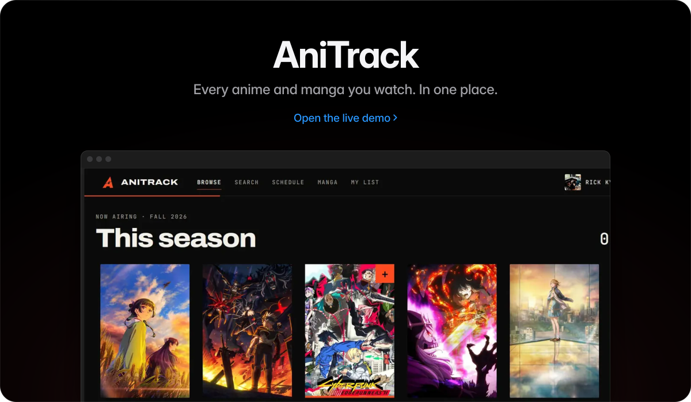
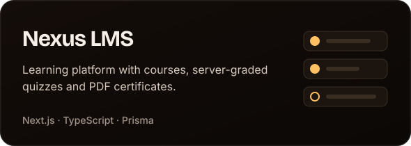
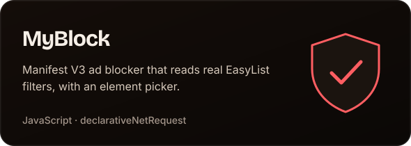
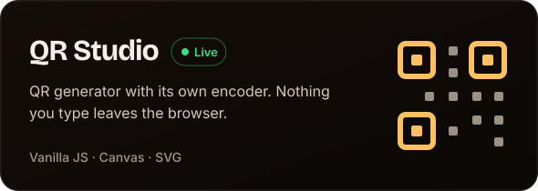
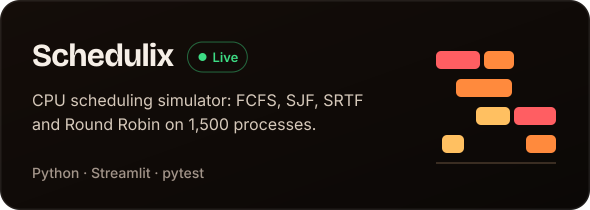
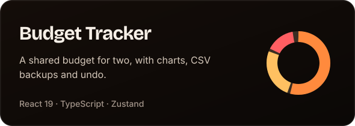
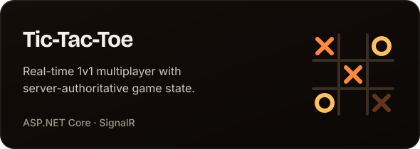

 

<!-- Once MyPortfolio is deployed, uncomment and set the URL:

-->

I build the software I want to use myself: an anime tracker because I watch too much anime,
a football manager because I can't stop playing them, a budget app for me and my roommate.
Most of it ships with a live demo.

  
  

### More projects

  
  
  
  
  
  

Cards marked Live open the demo; the rest open the code. Source for everything is on my <a href="https://github.com/muthokaricky-alt?tab=repositories">repositories page</a>, including <a href="https://github.com/muthokaricky-alt/QR-Studio">QR Studio</a> and <a href="https://github.com/muthokaricky-alt/Schedulix-">Schedulix</a>.

### What I build with

### Off the keyboard

Anime and manga (that's where AniTrack came from), football, films, series and music.
