<picture>
  <source media="(prefers-color-scheme: dark)" srcset="assets/hero.svg" />
  <source media="(prefers-color-scheme: light)" srcset="assets/hero-light.svg" />
  
</picture>

<a href="mailto:muthokaricky@gmail.com"><picture><source media="(prefers-color-scheme: dark)" srcset="assets/btn-email.svg" /><source media="(prefers-color-scheme: light)" srcset="assets/btn-email-light.svg" /></picture></a>&nbsp;
<a href="https://www.linkedin.com/in/rick-kyalo-46116a38b"><picture><source media="(prefers-color-scheme: dark)" srcset="assets/btn-linkedin.svg" /><source media="(prefers-color-scheme: light)" srcset="assets/btn-linkedin-light.svg" /></picture></a>&nbsp;
<a href="https://github.com/muthokaricky-alt?tab=repositories"><picture><source media="(prefers-color-scheme: dark)" srcset="assets/btn-github.svg" /><source media="(prefers-color-scheme: light)" srcset="assets/btn-github-light.svg" /></picture></a>

 

<picture>
  <source media="(prefers-color-scheme: dark)" srcset="assets/terminal.svg" />
  <source media="(prefers-color-scheme: light)" srcset="assets/terminal-light.svg" />
  
</picture>

<picture>
  <source media="(prefers-color-scheme: dark)" srcset="assets/stats.svg" />
  <source media="(prefers-color-scheme: light)" srcset="assets/stats-light.svg" />
  
</picture>

### Featured projects

<a href="https://github.com/muthokaricky-alt/xGenius"><picture><source media="(prefers-color-scheme: dark)" srcset="assets/project-xgenius.svg" /><source media="(prefers-color-scheme: light)" srcset="assets/project-xgenius-light.svg" /></picture></a>
<a href="https://github.com/muthokaricky-alt/AniTrack"><picture><source media="(prefers-color-scheme: dark)" srcset="assets/project-anitrack.svg" /><source media="(prefers-color-scheme: light)" srcset="assets/project-anitrack-light.svg" /></picture></a>
<a href="https://github.com/muthokaricky-alt/Touchline"><picture><source media="(prefers-color-scheme: dark)" srcset="assets/project-touchline.svg" /><source media="(prefers-color-scheme: light)" srcset="assets/project-touchline-light.svg" /></picture></a>
<a href="https://github.com/muthokaricky-alt/CampusSeat"><picture><source media="(prefers-color-scheme: dark)" srcset="assets/project-campusseat.svg" /><source media="(prefers-color-scheme: light)" srcset="assets/project-campusseat-light.svg" /></picture></a>
<a href="https://github.com/muthokaricky-alt/SkillBridge"><picture><source media="(prefers-color-scheme: dark)" srcset="assets/project-skillbridge.svg" /><source media="(prefers-color-scheme: light)" srcset="assets/project-skillbridge-light.svg" /></picture></a>
<a href="https://github.com/muthokaricky-alt?tab=repositories"><picture><source media="(prefers-color-scheme: dark)" srcset="assets/project-more.svg" /><source media="(prefers-color-scheme: light)" srcset="assets/project-more-light.svg" /></picture></a>

<b>Try them live:</b> <a href="https://xgenius.pages.dev">xGenius</a> · <a href="https://anitrack.muthokaricky.workers.dev/">AniTrack</a> · <a href="https://touchline.muthokaricky.workers.dev">Touchline</a> · <a href="https://campusseat.onrender.com/">CampusSeat</a> <i>(free hosting: the AniTrack and CampusSeat APIs can take up to a minute to wake)</i>

  

<picture>
  <source media="(prefers-color-scheme: dark)" srcset="assets/languages.svg" />
  <source media="(prefers-color-scheme: light)" srcset="assets/languages-light.svg" />
  
</picture>

### Currently

- **Building:** Touchline's mobile release (device testing now), and re-checking xGenius's xG blend as the 2026/27 season plays out
- **Learning:** API design, game development (React Native / Expo), full-stack web, and cloud deployment (Cloudflare, Render, Neon Postgres)
- **Open to:** software engineering internships, remote, or in Nairobi or Mombasa

<a href="mailto:muthokaricky@gmail.com">Email</a> · <a href="https://www.linkedin.com/in/rick-kyalo-46116a38b">LinkedIn</a> · <a href="https://github.com/muthokaricky-alt">GitHub</a>

Cards regenerate daily from the GitHub API: <a href="scripts/generate.mjs">scripts/generate.mjs</a>

