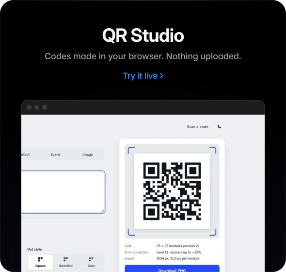
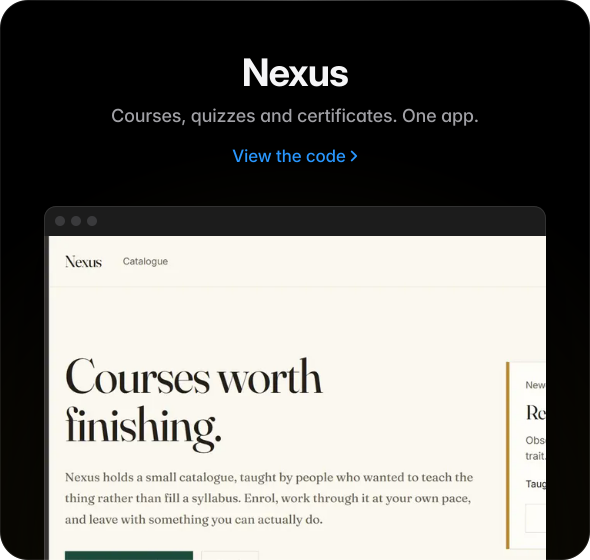
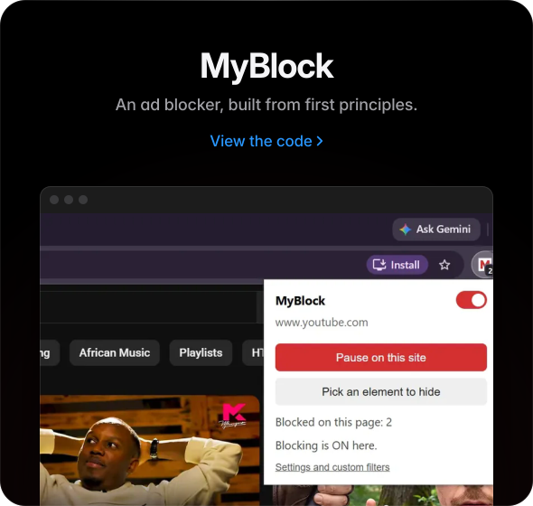

  
  &nbsp;
  
  &nbsp;
  
  <!-- Once MyPortfolio is deployed, add a button for it here. -->

 

<picture>
  <source media="(prefers-color-scheme: dark)" srcset="assets/h-live.svg" />
  
</picture>

  
  

 

<picture>
  <source media="(prefers-color-scheme: dark)" srcset="assets/h-works.svg" />
  
</picture>

  

<picture>
  <source media="(prefers-color-scheme: dark)" srcset="assets/h-more.svg" />
  
</picture>

  
  

  
  

Also: a <a href="https://github.com/muthokaricky-alt/TicTacToe">real-time Tic-Tac-Toe</a> in ASP.NET Core and SignalR.

  

  

Off the keyboard: anime and manga (that's where AniTrack came from), football, films and music.

