 

<!-- Once MyPortfolio is deployed, uncomment and set the URL:

-->

I build the software I want to use myself: an anime tracker because I watch too much anime,
a football manager because I can't stop playing them, a budget app for me and my roommate.
Most of it ships with a live demo.

  
  

### More projects

| Project | What it is | Built with | |
| --- | --- | --- | --- |
| [**Nexus LMS**](https://github.com/muthokaricky-alt/NexusLS) | Learning platform for students, instructors and admins, with server-graded quizzes and PDF certificates | Next.js · TypeScript · Prisma · Docker | |
| [**MyBlock**](https://github.com/muthokaricky-alt/MyBlock) | Manifest V3 ad blocker that parses real EasyList syntax, with an element picker | JavaScript · declarativeNetRequest · CI | |
| [**QR Studio**](https://github.com/muthokaricky-alt/QR-Studio) | QR generator with a hand-written encoder that runs entirely in the browser | Vanilla JS · Canvas · SVG | [Live ↗](https://muthokaricky-alt.github.io/QR-Studio/) |
| [**Schedulix**](https://github.com/muthokaricky-alt/Schedulix-) | CPU scheduling simulator comparing FCFS, SJF, SRTF and Round Robin | Python · Streamlit · pytest | [Live ↗](https://muthokaricky-alt-schedulix--app-qcf6ny.streamlit.app/) |
| [**Budget Tracker**](https://github.com/muthokaricky-alt/budget-tracker) | Shared budget app with charts, CSV import and export, and unit tests | React 19 · TypeScript · Zustand · Vitest | |
| [**Tic-Tac-Toe**](https://github.com/muthokaricky-alt/TicTacToe) | Real-time multiplayer with server-authoritative game state | ASP.NET Core · SignalR | |

### What I build with

### Off the keyboard

Anime and manga (that's where AniTrack came from), football, films, series and music.
